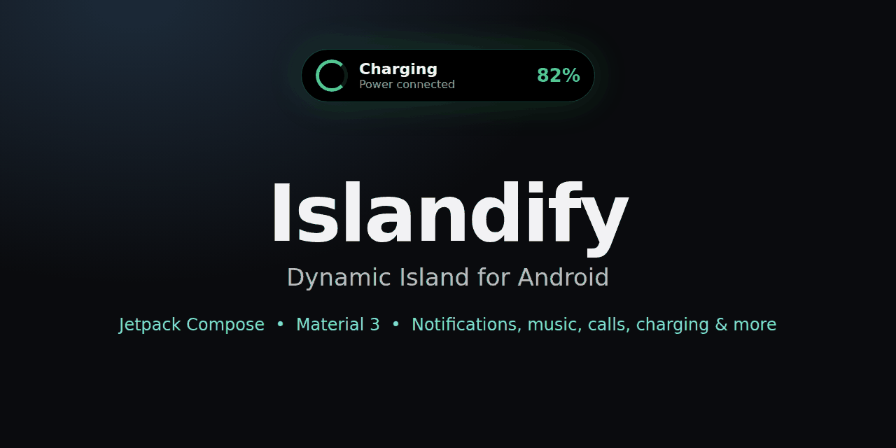

<!-- README2KIT -->
<p align="center">
  
</p>

# Islandify

**Dynamic Island for Android.** A small black pill at the top of your screen that grows into a banner or a card for notifications, calls, music, charging, timers, navigation, deliveries and more. Messages wait as small bubbles next to the pill. Everything can be customized, and the app is available in **English and Hindi**.

Built with Kotlin, Jetpack Compose and Material 3.

> Package: `com.islandify.app` | Version 1.3 | Android 8.0+ (API 26) | Target SDK 34 / compile SDK 35

Telegram: https://t.me/Zyron_Official_26 | https://t.me/Zyron_Community_26

<!-- SCREENSHOTS -->
## Screenshots

_Screenshots coming soon. Add real screenshots to `docs/images/` (home.png, pill.png, banner.png, music.png, call.png, message_card.png, bubbles.png, customize.png, apps.png) and run `python update_release.py` again._
<!-- /SCREENSHOTS -->

<!-- WHATSNEW -->
## What's new in 1.3

- **Smoother and faster.** The app now ships a baseline profile, so scrolling, opening tabs and the first launch are smooth right after install.
- **Settings save in the background.** Dragging sliders and flipping switches no longer causes small hitches. Settings are also saved when the app goes to the background.
- **First notification of an app no longer stutters.** Its icon loads in the background and appears a moment later.
- **Lighter on battery.** The island position check runs less often while everything is fine.
- Backup export now always contains your latest settings.

Full history: [CHANGELOG.md](CHANGELOG.md)
<!-- /WHATSNEW -->

## What the island shows

Every activity below can be turned on or off in the **Activities** tab, and notifications can be blocked per app in the **Apps** tab.

| Activity | What happens |
|---|---|
| Notifications | Messages and alerts pop up on the island. **Reply** (with a keyboard on the island) and the notification's own buttons (**Mark as read**, **No thanks**, **Turn on** ...) work from the card. |
| Music and media | Album art, a moving sound wave, play / pause / next / previous and a progress bar. An optional Apple-style card has a thin bar and bigger buttons. |
| Calls | Incoming, outgoing and ongoing calls. **Decline**, **Answer**, **Speaker** and **Mute** are buttons right in the pill. |
| Charging | A battery banner when you plug in or unplug. Shows fast or wireless charging, the approximate watts and the time left to full (when the phone reports them). |
| Timer | Countdown for the in-app timer and for the Clock app timer. |
| Bluetooth and headphones | The earbuds name when they connect, and their battery level when the phone can read it. |
| Low battery | A warning at 20% and 10% while not charging. |
| Quick toggles | Silent, Vibrate, Do Not Disturb and Flashlight, plus Hotspot and VPN. |
| Wi-Fi and airplane mode | A quick banner when Wi-Fi connects or drops, or airplane mode changes. |
| Camera, mic and screen recording | A banner when an app uses the camera or microphone, or the screen is being recorded (where the phone supports it). |
| Downloads | A live progress ring for downloads and uploads. |
| Navigation | Live directions from Google Maps, Waze and OsmAnd. |
| Delivery and rides | Live order and ride status from Zomato, Swiggy, Uber and similar apps. |
| Silent and ongoing notifications | Optional: also show silent, always-on and background notifications. |

**Idle pill.** When nothing is showing, the pill can show the time and battery, your next alarm, and (with calendar permission) your next calendar event.

**Flashlight pill.** The island stays while the flashlight is on. Tap it for a brightness slider (Android 13+).

**Priority.** If music, a timer and navigation run together, the island shows the one at the top of your priority list. You can reorder it. Calls always come first.

## Pop-ups: banners and cards

Quick pop-ups (notifications, charging, earbuds, low battery, toggles) appear as a slim banner. Tap the banner to open the full card. Long-press for the large card. Banners, bubbles and cards each have their own size, corner, opacity, text size and glow settings.

If several messages arrive together, tap the first banner and only that message opens as a card. The rest wait as bubbles.

## Calls in the pill

- **Incoming call:** the pill shows the caller with Mute, Speaker, Decline and Answer.
- **Outgoing or ongoing call:** the pill shows the caller, a timer, and Mute, Speaker and Hang up.
- Tap the pill for the full call card.
- Answer and hang up use the call notification's buttons. If a dialer does not provide them, you can allow **call control** (answer / end calls) for Islandify. If something cannot be changed during a call, Islandify opens the call screen instead.

## Bubbles and message card

Messages, live activities (maps, delivery, rides), charging, Bluetooth, low battery and quick toggles wait as small bubbles beside the pill. When more than three chats wait, a count badge shows how many (up to 99+). Bubbles step aside while a call is on, and hide when there is no room next to the pill.

- **Tap a bubble** to open its message card. The card shows up to four of the notification's own buttons, plus **Reply**.
- **Swipe the card up** to hide it back into its bubble.
- **Swipe the card left or right** to dismiss the message. A red **Dismiss** hint shows while you swipe. Optionally the notification is also removed from the notification shade.
- **Swipe a bubble sideways** to clear all its messages (can be turned off).
- A dismissed message does not come back again for about 10 minutes.

## Gestures on the island

| Gesture | Default action |
|---|---|
| Tap | Expand the pill or banner into a card. |
| Tap the card | Open the app the music or notification came from. |
| Long-press | Large mode. |
| Swipe up | Collapse, then hide the island. |
| Swipe left / right | Next / previous track. |
| Swipe down | Nothing. |
| Tap a bubble | Open its message card. |

The four swipe directions can each be set to: do nothing, dismiss / hide, clear all pop-ups, open the card, open the app, next or previous track, play / pause, volume up or down, switch sound mode, toggle the flashlight, or show the next notification.

## The app

- **Home:** on / off switch, a live preview (Pill / Banner / Card with Message, Music, Timer, Charging, Call or Earbuds), quick switches, and a **Test on the real island** card that fires sample messages, calls, charging, earbuds, a timer, delivery and navigation so you can check your settings. Help for missing permissions shows only while something is missing.
- **Activities:** turn each activity on or off.
- **Customize:** see below.
- **Apps:** search your apps, show system apps, block or allow each one, or **Allow all** / **Block all**.
- **About:** setup status, device info, gesture list, what Islandify does, and help if taps do not work or the island keeps stopping.

First launch opens a short **setup screen** for the permissions.

## Customize

Customize has four groups: **Pill** (opens Placement, Visuals, Duration and Behavior), **Bubble**, **Message card** and **Banner**, plus app-wide options on the main page. A **search bar** at the top finds any setting (try "scroll" or "opacity") and jumps straight to it. Rarely used Behavior options sit in a collapsible **Advanced** section.

| Page | What you can change |
|---|---|
| **Placement** | Shape presets (Small, Normal, Large, Wide, Tall), width and height, left / right and up / down position in 1 dp steps, **auto align with the front camera**, and the length, height and card size of each activity (**Pop-ups and activities**). |
| **Visuals** | Corner roundness, card corner, island text size, accent glow (optionally using your app color), border outline (thickness, dynamic colors, hide when the card is open), glow flash on a new pop-up, and text size and corners per activity. |
| **Duration** | Auto-collapse time for cards, animation speed, glow flash duration, and how long each pop-up stays (show time per activity). |
| **Behavior** | The four swipe gestures. Visibility rules: show when (Unlocked, Screen on, Always), only on the home screen, hide inside its own app, hide in landscape, tap outside to close. **Quiet hours** and hide in games and video apps. Idle pill (time, battery, alarm, next calendar event), flashlight pill, camera / mic banners and vibration feedback. Notifications and music (swipe also clears the notification, open card on song change, keep the pill while paused, Apple-style music card, music / timer / downloads as bubbles). Activity priority. Lock screen privacy (hide message text and sender photos). |
| **Bubble** | Size, gap from the pill, up / down, opacity, swipe to clear and swipe distance. |
| **Message card** | Width, up / down, corner, text size, opacity, accent strength, message lines, text auto-scroll speed, buttons, bubbles row, and swipe distances. |
| **Banner** | Width, height, up / down, corner, text size, opacity, glow strength, second line and badge. |

App-wide options on the main Customize page: theme (System, Light, Dark, AMOLED), accent color (wallpaper colors with Material You, or your own color), app background (default or tinted, with color, brightness and strength), **language (English or Hindi)**, **Backup and restore** (save all settings to a file and load them back) and **Reset everything**.

A **Quick Settings tile** turns the island on and off.

## Install

1. Download the latest APK from the [Releases](../../releases) page and install it.
2. Open Islandify and grant the permissions in the setup screen:
   - **Accessibility service** shows the island above the status bar so taps work. It does not read your screen.
   - **Notification access** lets the island see messages, calls and music.
   - **Show notifications** for the small "Islandify is running" notification that keeps it alive.
   - **Nearby devices (Bluetooth)** is optional, for earbud names.
   - **Battery: no restrictions** stops the system from closing the island.
3. If a switch is greyed out: *App info > three-dot menu > Allow restricted settings*.

Optional permissions you can grant later: **call control** (answer / end calls from the island) and **calendar** (next event on the idle pill).

### If the island keeps stopping
Some phones (Xiaomi, Oppo, Vivo, Realme, Samsung) close background apps. Set battery to *No restrictions*, turn Autostart on (Xiaomi / Oppo / Vivo) and lock Islandify in the Recent apps screen.

## Known limits

- **Lyrics** cannot be shown. Android does not give lyrics to other apps.
- On many phones, **Mute** and **Speaker** do not work until the call is answered.
- The camera cut-out position differs between phones. Use **Auto align with camera**, then fine-tune with the position sliders if the island is slightly off.
- Two messages from different chats arriving within about 300 ms can show in the wrong order (rare).
- Text shown inside the island itself (for example "Charging", "Battery low", "Reply") is currently in English only. The rest of the app is in English and Hindi.

## Build from source

Requirements: JDK 17, Android SDK 35.

```bash
git clone https://github.com/bughunter11/Islandify.git
cd Islandify
./gradlew assembleRelease
```

The APK is created in `app/build/outputs/apk/release/`.

- **Signing:** if `keystore.properties` exists in the project root (`storeFile`, `storePassword`, `keyAlias`, `keyPassword`), the release build uses that key. Without it, the release build is signed with the debug key so it still installs. Never commit `keystore.properties` or `*.jks`.
- Use the **release** build for real speed. Debug builds are much slower in Compose.
- Release builds use code shrinking (`isMinifyEnabled`, `isShrinkResources`).

## Project layout

```
app/src/main/java/com/islandify/app/
  core/      settings (StateFlow + SharedPreferences), permissions, language
  island/    controller (single source of truth), notification listener,
             overlay + island UI, bubbles and message card, accessibility
             and foreground services, Quick Settings tile
  ui/        screens (Home, Activities, Customize, Apps, About, Onboarding),
             shared components, theme and palette
app/src/main/res/  values/strings.xml (English), values-hi/strings.xml (Hindi)
```

## Tech stack

- Kotlin 2.0.21, Android Gradle Plugin 8.7.3, Gradle 8.9
- Jetpack Compose (BOM 2025.05.01) and Material 3
- [material-kolor](https://github.com/jordond/MaterialKolor) 2.0.0 for HCT color palettes from a seed color
- AndroidX Core, Activity, Lifecycle, SplashScreen, ProfileInstaller, and Material Components (for the XML theme)
- Kotlin Coroutines and StateFlow

## Privacy

Everything runs on your device. Islandify does **not** request the Internet permission, so it cannot send your notifications or any other data anywhere. It does not record your screen.

| Permission | Why |
|---|---|
| Notification listener | Shows messages, calls, music, timers and live activities on the island. |
| Accessibility service | Draws the island above the status bar and knows which app is open. It does not read your screen. |
| Overlay (draw over apps) | Fallback when the accessibility service is off. |
| Post notifications, foreground service | The small "Islandify is running" notification that keeps the island alive. |
| Bluetooth (connect) | Earbud names and battery. Optional. |
| Answer phone calls | Answer / end calls from the island. Optional. |
| Read calendar | Next event on the idle pill. Optional. |
| Query all packages | Lists your apps in the Apps tab so you can block them. |
| Modify audio settings | Speaker and mute buttons during a call. |
| Ignore battery optimizations | Keeps the island from being closed. |
| Network state | Wi-Fi and airplane mode banners (it does not use the Internet). |
| Detect screen recording | Screen recording banner. |

## Contributing

Issues and pull requests are welcome. If you change the UI, please add a screenshot to `docs/images/`. Add every new text to both `values/strings.xml` and `values-hi/strings.xml`.

## License

MIT, see [LICENSE](LICENSE).
